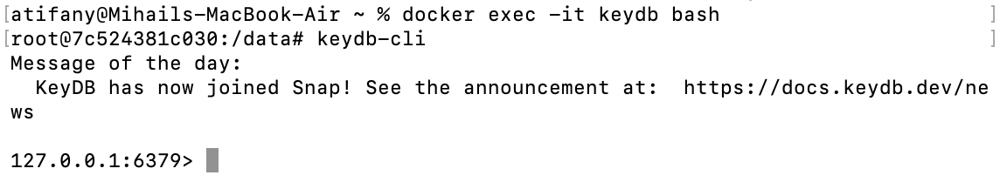
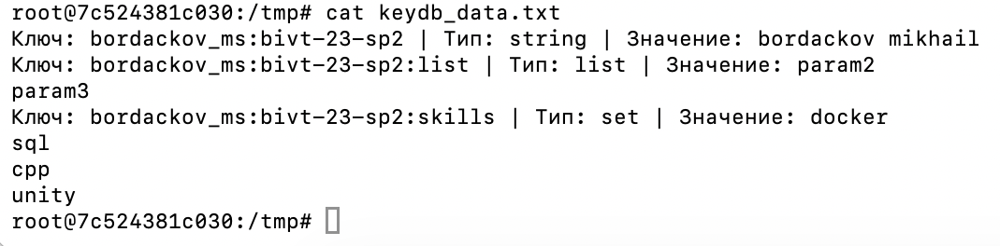

# Architecturing-LR2

Redis - NoSQL субд в формате ключ-значение на ОЗУ для кэшировния

Cash-aside - при этой стратегии приложение само управляет связью между базой данных (БД) и кэшем. Кэш ничего не знает о БД, а БД ничего не знает о кэше.

алгоритм работает следующим образом:

1. Чтение данных (Запрос от пользователя)
2. Приложение получает запрос на данные и сначала идет в кэш.
3. Cache Hit (Данные есть в кэше): Приложение мгновенно возвращает их пользователю. В БД идти не нужно.
4. Cache Miss (Данных в кэше нет):
	• Приложение идет в основную БД и забирает данные оттуда.
	• Приложение записывает эти данные в кэш (чтобы в следующий раз они там были).
	• Данные возвращаются пользователю.
5. Запись/Обновление данных
Когда данные меняются (пользователь обновил профиль, изменилась цена товара):
6. Приложение записывает новые данные напрямую в основную БД.
7. Приложение удаляет (инвалидирует) старый ключ из кэша (или обновляет его).

Стратегии кэширования:
Cash-aside - приложение решает свои связи между БД и кэшем.
Read-through - кэш сам читает с БД
Write-through - запись идет сразу и в кэш и в БД
Write-behind - запись идет в кэш, а потом в БД
Write-around - запись идет в БД, а потом в кэш

Стратегии вытеснения кэша — это алгоритмы, которые определяют, какие именно данные нужно удалить из кэша, когда в нем заканчивается выделенная оперативная память, чтобы освободить место для новых записей.
LRU (Least Recently Used — Давно не использовавшийся)
LFU (Least Frequently Used — Редко использовавшийся)

Вход в контейнер keydb

Результат предварительной работы с keydb:

